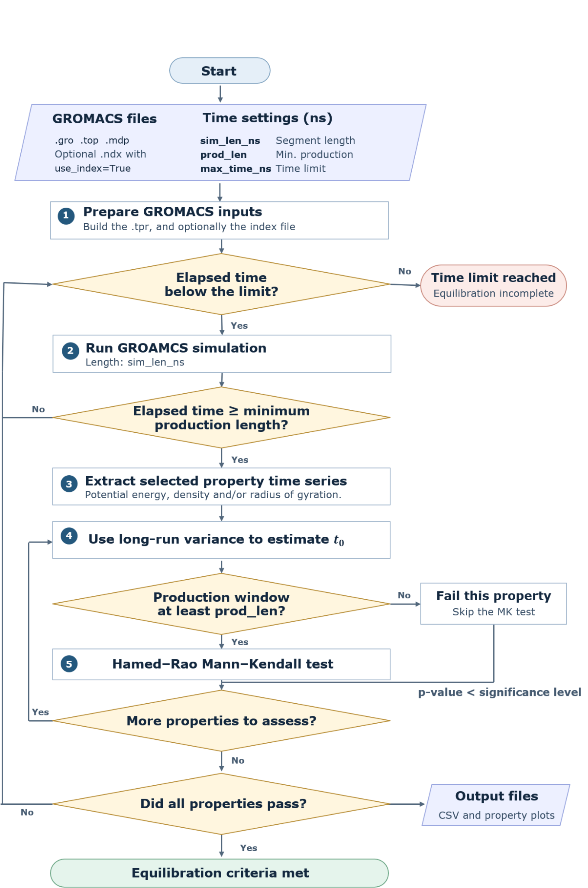

# PolyPlateau

## Introduction

PolyPlateau is an automated GROMACS simulation procedure, designed for polymers, which monitors the behaviour of key system properties (currently supported: potential energy, density and radius of gyration) over time. By determining when the monitored properties reach a plateau of user-specified minimum duration, PolyPlateau identifies a time ($t_0$), the data after which forms a production period which can be used for accurate property extraction.

## Installation 

PolyPlateau requires the GROMACS molecular dynamics package. This code was tested on version 2024.6. 

From the project directory, run the following command to install the required Python packages:

```bash
python -m pip install -r requirements.txt
```
Alternatively, install the following packages into your own environment:

### Python dependencies

| Package | Version |
| --- | --- |
| `numpy` | `2.2.6` |
| `pandas` | `2.3.3` |
| `matplotlib` | `3.10.7` |
| `red-molsim` | `0.2.0` |
| `pymannkendall` | `1.4.3` |

## Usage and Example

### Concept 

The workflow is summarised in the chart below:


